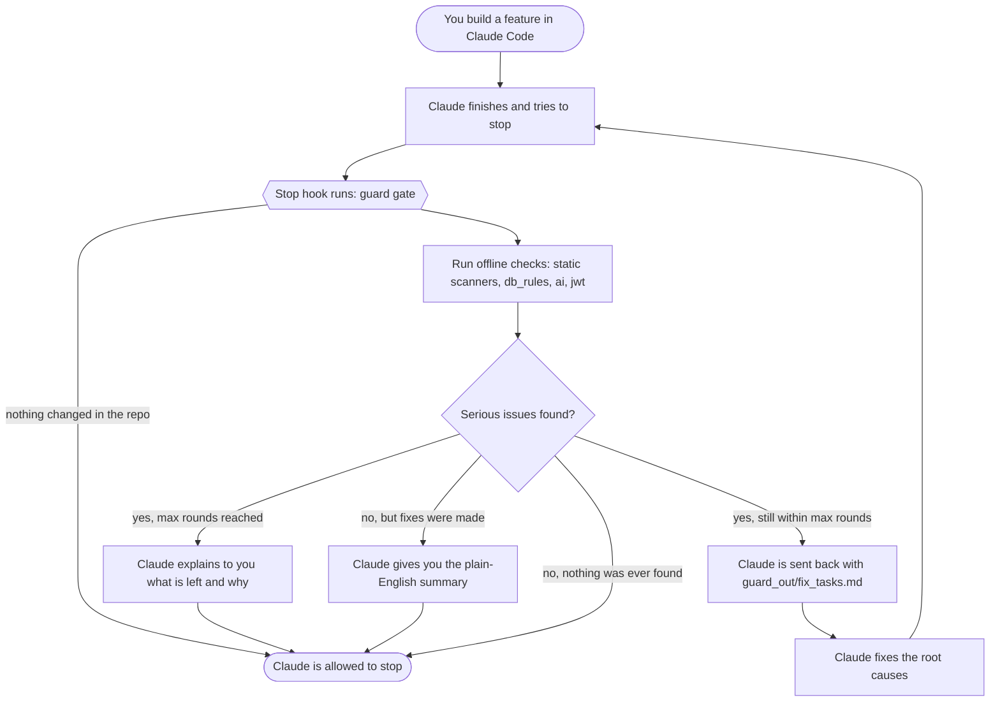
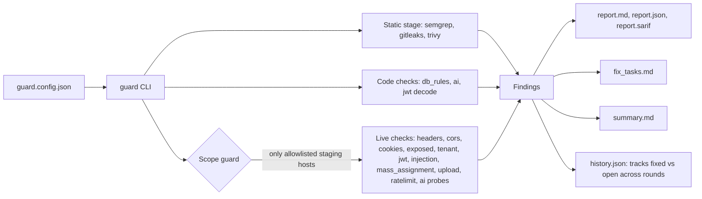

# guard

**A self-owned security testing kit for the apps you build, with an auto-fix loop for Claude Code.**

guard scans your code and your running staging app for common, high-impact security mistakes. When it finds a serious one, it hands the problem to your coding agent, waits for the fix, tests again, and repeats until clean. Then it gives you a plain-English summary.

- **One command to run everything:** `/guard` in Claude Code, `guard scan` in a terminal.
- **No third-party Python dependencies.** The standard library only, so there is no package here that could be poisoned. The whole kit is readable in an afternoon.
- **Safe by default.** Live checks refuse any host you have not listed, and refuse anything that looks like production.
- **Works for any app.** SaaS, marketplaces, AI products, internal tools. Nothing is tied to one domain.

---

## Contents

1. [How it works](#how-it-works)
2. [Quick start](#quick-start)
3. [Using guard with Claude Code](#using-guard-with-claude-code)
4. [What it checks](#what-it-checks)
5. [Configuration reference](#configuration-reference)
6. [Output files and exit codes](#output-files-and-exit-codes)
7. [CI/CD and scheduled scans](#cicd-and-scheduled-scans)
8. [Safety model](#safety-model)
9. [Project structure](#project-structure)
10. [Adding your own check](#adding-your-own-check)
11. [Limitations and status](#limitations-and-status)
12. [FAQ](#faq)

---

## How it works

guard has three parts: **checks** that find problems, a **scope guard** that keeps network checks pointed only at systems you own, and a **fix loop** that turns findings into fixes and re-tests them.

### The fix loop

This is what happens in Claude Code every time Claude finishes a task:



In words:

1. When Claude tries to finish, the **Stop hook** runs `guard gate`.
2. The gate runs the checks that need no network: static scanners, database rules, AI-app code checks and token checks.
3. If anything at or above your `fail_on` severity (default `high`) is found, the gate blocks the stop and sends Claude back to work with `fix_tasks.md`, a prioritized list with the file, the problem and a suggested fix.
4. Claude fixes the issues. The hook runs again automatically. This repeats for up to `max_fix_rounds` (default 5).
5. When the scan is clean after fixes, Claude must present a **plain-English summary** (what was found, what changed, how many rounds, what is left) before it can stop.
6. If the issues cannot be fixed in time, Claude stops and explains what remains and why.

The gate never runs live network checks on its own. Those run when you ask for them with `/guard` or `guard scan`.

### The architecture



Every network request goes through one gate, the scope guard. If a host is not in `allowed_hosts`, or looks like production, the request is refused and the scan aborts with exit code 3.

---

## Quick start

Install once, then use `/guard` in any project.

```bash
# 1. Install guard (use your repo's address)
git clone https://github.com/adithyaraghavv/gaurd.git   # note the spelling: the repo is named "gaurd"
pip install ./gaurd

# 2. One-time Claude Code setup: installs the /guard command for every project
guard setup
```

That is the whole setup. From now on, in any project:

1. Open Claude Code in the project folder.
2. Type `/guard`.

The first time in a project, `/guard` sets itself up (runs `guard init`, adds guard's files to `.gitignore`) and then runs the full loop. Nothing needs copying into your apps.

**Requirements:** Python 3.10 or newer. The scanners semgrep, gitleaks and trivy are optional; every other check works without them.

**Without Claude Code**, use it as a plain command line tool:

```bash
cd your-app
guard init                 # writes guard.config.json (edit your staging URL, tokens, routes)
guard scan --no-live       # code only: safe to run anywhere
guard scan                 # code + live checks against staging
```

---

## Using guard with Claude Code

`guard setup` installs these into your user-level Claude Code folder (`~/.claude/`), so they apply to every project:

| What | Where | What it does |
|---|---|---|
| `/guard` command | `~/.claude/commands/guard.md` | You type `/guard`; Claude sets guard up in the project if needed and runs the full fix loop, ending with the summary |
| Rules | A marked block in `~/.claude/CLAUDE.md` | Standing security and quality rules, including "do not weaken guard to hide a finding" (skip with `--no-rules`) |
| **Stop hook** (optional) | `~/.claude/settings.json` | Added with `guard setup --hook`. Runs `guard gate` whenever Claude finishes, in projects that have a `guard.config.json`, and drives the fix loop automatically |

`guard setup --project` installs the same things into the current project (`./.claude`) instead, so teammates who clone the repo get them. The setup is safe to re-run: it never overwrites your other settings and never adds anything twice.

Set `GUARD_GATE=off` to switch the automatic hook off for a session. The hook does nothing in projects without a `guard.config.json`, and nothing when the repo has no changes.

### Claude Code in the browser (cloud sessions)

A browser session (claude.ai/code) runs in the cloud, so it cannot see the `~/.claude` folder on your computer. Install guard **into the project** instead, so the command travels with the repo:

```bash
cd your-app
git checkout -b guard-test
guard setup --project --repo adithyaraghavv/gaurd
git add .claude CLAUDE.md .gitignore
git commit -m "Add guard"
git push -u origin guard-test
```

Then start a **new** browser session on that repo and branch, and type `/guard`. Because of `--repo`, the command knows how to install guard inside the cloud session on its own: it adds your guard repo to the session (read access), clones it and runs `pip install`. Nothing else to set up.

### What a session looks like

```
You:     Add a notes feature with a database table.
Claude:  (builds it, tries to finish)
Hook:    2 blocking issues: table 'notes' has no row-level security;
         secret key exposed to the browser (app.js:1). Fix round 1 of 5.
Claude:  (enables RLS with an owner policy, moves the key to a server-only variable)
Hook:    All blocking issues fixed after 2 rounds. Present the summary.
Claude:  Found 2 high-severity issues, fixed both, 2 rounds, nothing left open,
         and here is what guard could not verify: ...
```

Or type `/guard` yourself at any time to run the whole loop on demand, including live staging checks if you confirm they are safe.

---

## What it checks

| Check | What it looks for | Needs network |
|---|---|---|
| `headers` | Missing security headers (HSTS, CSP, nosniff, referrer policy, clickjacking), server version leaks | Yes |
| `cors` | A site you do not own being allowed to read responses, especially with credentials | Yes |
| `cookies` | Session cookies missing `HttpOnly`, `Secure` or `SameSite` | Yes |
| `exposed` | Public `.env`, `.git`, database dumps, debug and status pages (verified by content, so single-page apps do not cause false alarms) | Yes |
| `tenant` | User B reading user A's data, and routes that work with no login at all (IDOR / broken access control). A `200` with an empty body is treated as correct row-level-security behavior, not a leak | Yes |
| `jwt` | Tokens that never expire or use `alg=none`; the server accepting forged copies of your own test token | Partly |
| `injection` | SQL injection signs: database errors after a single quote, and true/false response differences. Never destructive | Yes |
| `mass_assignment` | A client being able to set `role`, `is_admin`, `tenant_id`, `owner_id` | Yes |
| `upload` | Dangerous file types accepted (`.php`, `.html`, `.svg` with script, `.exe`) | Yes |
| `ratelimit` | No throttling on your login route | Yes |
| `db_rules` | SQL tables without row-level security, and policies that match every row. Judged by command and role: an anonymous read-only policy is low, writes or reads by every signed-in user are high | No |
| `db_access` | `SECURITY DEFINER` functions without a fixed `search_path`; functions anyone can run; views without `security_invoker`; grants wider than the policies; public storage buckets and unscoped storage policies; service-role keys in front-end files | No |
| `access` | Role-based rules you write (caller, path, expected `denied` / `empty` / `allowed`), for apps with roles instead of two tenants | Yes |
| `ai` | Model keys exposed to the browser, model output reaching `eval` or raw HTML, prompt-injection leaks (via canary strings) | Partly |
| static stage | semgrep (code patterns), gitleaks (secrets), trivy (vulnerable dependencies), when installed | No |

Findings have five severities: `info`, `low`, `medium`, `high`, `critical`. Only findings at or above `fail_on` block the loop.

### The most valuable check: tenant isolation

For any app where users own data (workspaces, shops, teams, accounts), create two test accounts that must never see each other's data. Put account A's resource URLs in `tenant_a_resources` and both tokens in the config. guard requests each resource as the owner (must work), with no login (must fail) and as the other user (must fail). Any other result is a `critical` finding.

---

## Configuration reference

`guard init` writes a starter file. All keys are optional except where your checks need them.

| Key | Default | Meaning |
|---|---|---|
| `base_url` | `""` | The staging URL live checks run against |
| `allowed_hosts` | `[]` | **Required for live checks.** Only these hosts may be contacted |
| `allow_production` | `false` | Allow hosts that look like production. Leave off |
| `source_dir` | `"."` | Folder scanned by the code checks |
| `tenant_a_token`, `tenant_b_token` | `""` | Test-user tokens from two different tenants. Use `"ENV:VAR_NAME"` to read from an environment variable |
| `tenant_a_resources` | `[]` | Paths owned by tenant A, such as `/api/items/123` |
| `probe_paths` | `["/"]` | Routes used by header, CORS, cookie and injection checks |
| `injection_params` | `[]` | Query parameters to test for SQL injection |
| `rate_limit_path` | `""` | Login route to test for throttling |
| `rate_limit_attempts` | `30` | Requests sent to that route (max 100) |
| `mass_assignment_targets` | `[]` | List of `{"path", "method", "body"}` create/update endpoints |
| `upload_path`, `upload_field` | `""`, `"file"` | Upload endpoint and its form field |
| `ai_endpoint` | `{}` | `{"path", "method", "field"}` for a chat endpoint |
| `ai_canaries` | `[]` | Secret strings planted in your system prompt that must never be echoed |
| `max_fix_rounds` | `5` | Fix rounds before the loop stops and reports |
| `fail_on` | `"high"` | Lowest severity that blocks |
| `setup_complete` | `false` in a fresh `guard init` file | **Live scans are refused until you review the file and set this to `true`.** Also refused while `base_url` is a placeholder (`.example`, `.invalid`, `.test`) |
| `accepted_risks` | `[]` | Findings you reviewed and accept: `{"check", "title" and/or "target" (`*` allowed), "reason", "owner", "expires" (optional YYYY-MM-DD)}`. They stop blocking but are always listed in their own report section. Only the project owner adds these |
| `tokens` | `{}` | Named tokens for roles, e.g. `{"staff": "ENV:STAFF_TOKEN"}` |
| `check_tokens` | `{}` | Which token each check uses, e.g. `{"injection": "anonymous", "upload": "staff"}`. Default is tenant A |
| `access_checks` | `[]` | Role rules for the `access` check |
| `injection_targets` | `[]` | Injection inputs that are not query strings; `{payload}` marks the spot, e.g. `{"path": "/rest/v1/items?name=eq.{payload}"}` or `{"path": "/rpc/search", "method": "POST", "body": {"q": "{payload}"}}` |
| `max_probe_paths` | `5` | How many `probe_paths` the header, CORS, cookie and injection checks use. Paths beyond it are reported as unchecked |

Example:

```json
{
  "base_url": "https://staging.yourapp.example",
  "allowed_hosts": ["staging.yourapp.example"],
  "tenant_a_token": "ENV:TENANT_A_TOKEN",
  "tenant_b_token": "ENV:TENANT_B_TOKEN",
  "tenant_a_resources": ["/api/items/123"],
  "probe_paths": ["/", "/api/items"],
  "injection_params": ["q", "id"],
  "rate_limit_path": "/api/auth/login",
  "fail_on": "high"
}
```

---

## Reading a report honestly

Every report and summary opens with a **What ran** table: each check is `ran`, `SKIPPED` (it should have run but could not, with the reason), `off (by choice)` (`--no-live`, `--only`) or `not applicable` (nothing to check, such as no `.sql` files). The summary says **CLEAN** only when no blocking issue remains *and* nothing was skipped. Otherwise it says "no blocking issues found, but this is not a full clean" and names what did not run, for example a missing secret scanner.

`guard doctor` lists which scanners are installed, whether live scans are allowed, which tokens are set, and which checks your config actually enables. It changes nothing and sends nothing. guard does not download scanners for you; install semgrep, gitleaks and trivy yourself, pin the version and verify it.

### Accepting a known false alarm

If a finding is a false alarm or a deliberate choice (a public catalog table, say), the coding agent must not hide it and the scan must not stay red forever. Add it to `accepted_risks` yourself:

```json
"accepted_risks": [
  {"check": "db_rules", "title": "Public read policy * on 'plans' *",
   "reason": "Pricing plans are shown on the public website", "owner": "adi", "expires": "2027-06-30"}
]
```

It stops blocking, but it appears under **Accepted risks** in `report.md`, `summary.md` and `fix_tasks.md` with its reason and owner. After the expiry date it blocks again. An entry that matches nothing is reported as stale.

---

## Output files and exit codes

Everything is written to `guard_out/`:

| File | Purpose |
|---|---|
| `report.md` | Human-readable findings, sorted by severity |
| `report.json` | Same findings for scripts and dashboards |
| `report.sarif` | For GitHub code scanning |
| `fix_tasks.md` | Instructions and issue list for the coding agent |
| `summary.md` | Plain-English summary of the session: fixed, open, left for you |
| `history.json` | Memory across rounds, used to tell fixed from still open |

| Command | Exit code | Meaning |
|---|---|---|
| `guard scan` | `0` | No blocking findings |
| | `1` | Blocking findings exist |
| | `2` | Config error |
| | `3` | **Scope blocked** (a host was not allowed) or **live scan refused** (config not marked set up, or placeholder host). Nothing was sent |
| `guard gate` | `0` | Claude may stop |
| | `2` | Claude is sent back to fix issues, or to present the summary |

---

## CI/CD and scheduled scans

`.github/workflows/guard.yml` provides:

- **On every pull request:** the static scan, with results uploaded to GitHub code scanning.
- **Every Monday (and on demand):** a live scan of staging. If it finds problems, the workflow opens a GitHub issue containing the summary and keeps the full report as an artifact.

Set these repository secrets for the live job: `GUARD_CONFIG_JSON` (the contents of your config), `TENANT_A_TOKEN` and `TENANT_B_TOKEN`.

If the guard repo is private, other repos cannot install it without a token. Store a read-only personal access token as a secret and use it in the install URL.

---

## Safety model

- **Scope guard.** Live checks refuse any host not in `allowed_hosts`, and refuse production-looking hosts (`prod`, `production`, `www.`, `app.`) unless `allow_production` is set.
- **Staging only, dummy data only.** Most live checks only read. These ones **write** data to the endpoints you list: `mass_assignment`, `upload`, and the login attempts in `ratelimit` (up to 100 requests).
- **No exploitation.** Probes send a quote character, forged copies of *your own* test token, and harmless test files. They check responses; they do not extract data.
- **Honest agent rules.** `fix_tasks.md` and `CLAUDE.md` tell the agent to fix root causes and never to edit guard, its config or its scope to make findings disappear. A determined agent could still try, so review diffs, especially anything under `.claude/` or the guard config.
- **No secrets in the repo.** Tokens come from environment variables, and the config and output folder are git-ignored.

Only test systems you own or have written permission to test.

---

## Project structure

```
guard/
├── guard/
│   ├── cli.py            # commands: init, scan, gate, setup, doctor
│   ├── accept.py         # accepted risks
│   ├── coverage.py       # what ran / was skipped
│   ├── sqlscan.py        # SQL statement splitter for the static checks
│   ├── bodies.py         # is a response body empty?
│   ├── claude_setup.py   # `guard setup`: installs /guard, rules and hook for Claude Code
│   ├── assets.py         # the text that setup installs
│   ├── config.py         # settings and the starter config
│   ├── scope.py          # scope guard and HTTP client
│   ├── loop.py           # fix-loop memory, fix_tasks, summary, stop decisions
│   ├── runners.py        # semgrep / gitleaks / trivy wrappers
│   ├── report.py         # markdown, JSON, SARIF
│   ├── findings.py       # the Finding record
│   ├── files.py          # source-file walker
│   └── checks/           # one file per check
├── tests/                # 174 unit tests
├── .github/workflows/guard.yml
├── Dockerfile
├── TRUST.md              # what guard does and does not protect against
└── guard.config.example.json
```

---

## Adding your own check

A check is one file with a `run` function that returns findings. `http` is `None` when running offline, so network checks are skipped automatically.

```python
# guard/checks/robots.py
from ..findings import Finding

def run(cfg, http):
    status, _, body = http.request("GET", cfg.base_url.rstrip("/") + "/robots.txt")
    if status == 200 and "/admin" in body:
        return [Finding("robots", "low", "robots.txt reveals an admin path",
                        "Disallowed paths advertise sensitive routes.", cfg.base_url,
                        fix="Remove sensitive paths from robots.txt and protect them with auth.")]
    return []
```

Register it in `guard/checks/__init__.py` by adding it to `ALL_CHECKS`. If it works without network, also add its name to `OFFLINE_OK`. Add a unit test for its pure logic in `tests/`.

---

## Limitations and status

**What guard is not:**
- It is not a full penetration test. It catches common, high-value mistakes, not complex business-logic flaws.
- A clean report does not mean your app is secure. Code review, parameterized queries, row-level security and dependency updates still matter.
- It cannot tell whether your features work correctly for real users.
- The `ai` check is partly heuristic (pattern matching over source), so expect some false positives and misses. `db_rules` reads only `.sql` files, not policies created in a dashboard.

**Verification status:**
- 67 unit tests pass.
- The fix loop, give-up limit and summary were simulated end to end through `guard gate`.
- The live checks were tested against a deliberately vulnerable local server.
- Not yet verified: the Stop hook inside a live Claude Code session, and the semgrep / gitleaks / trivy wrappers against the real tools (they are tested on sample output only).

See [TRUST.md](TRUST.md) for the full trust model.

---

## FAQ

**Why not just use an existing pentest tool?**
Existing tools are powerful but run code and models you did not write. guard is small enough to audit, and its job is different: a repeatable safety net wired into your coding agent. It complements deeper tools.

**Does it call any AI model itself?**
No. guard finds and reports; your coding agent (Claude Code) does the fixing.

**Will the hook slow Claude down?**
It skips the scan when nothing in the repo has changed. Semgrep, if installed, is the slowest part.

**Can I run it without Claude Code?**
Yes. `guard scan` works anywhere and the CI workflow runs it on GitHub. Only the automatic fix loop needs Claude Code.

**What if a finding is a false positive?**
Tell your agent to say so in its summary with the reason. Do not silence the check. If a check is wrong in general, fix the check in the guard repo so every app benefits.
